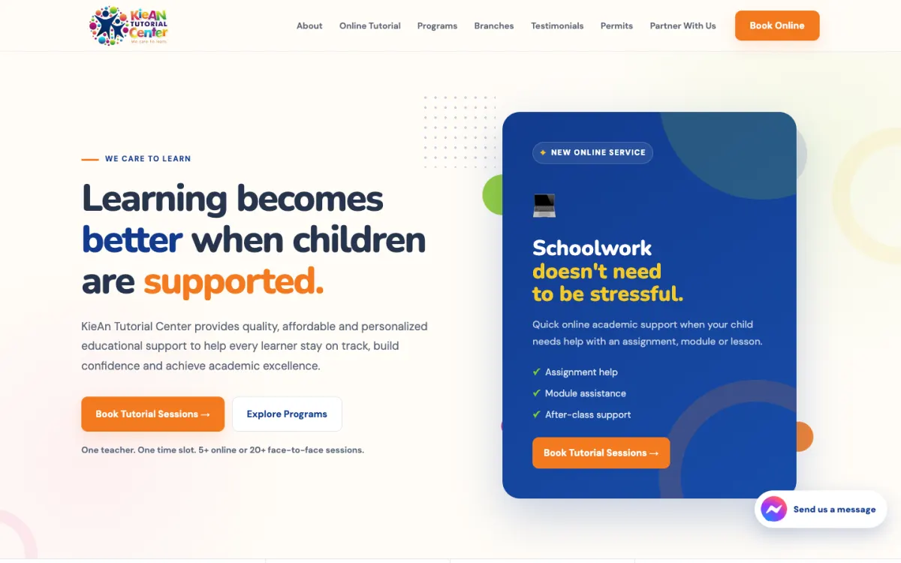
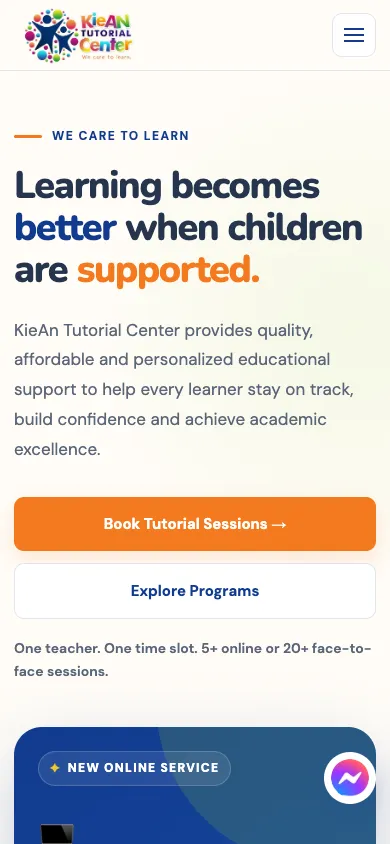
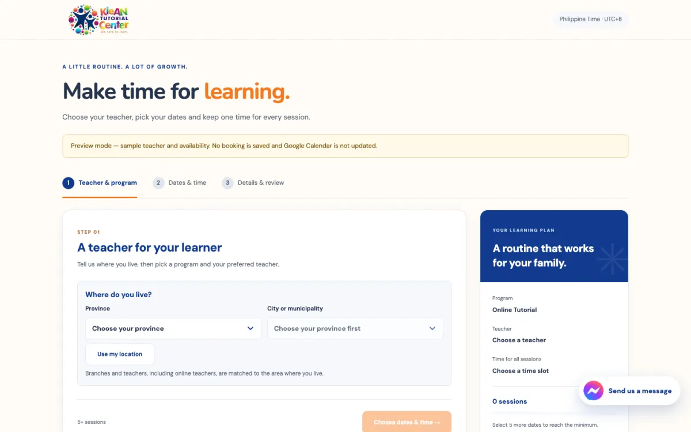
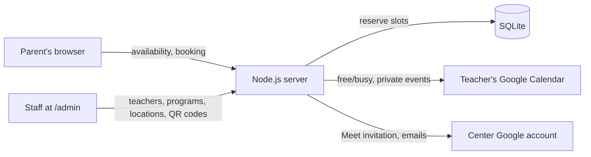

# KieAn Tutorial Center

**A tutoring center's website and booking system in one: parents book a teacher, a set of dates and one time slot, and every session lands on the teacher's Google Calendar.**

[Live site](https://kieantutorial.com) · [Roadmap](ROADMAP.md) · [Deploy guide](DEPLOY.md) · [Security](SECURITY.md) · [Contributing](CONTRIBUTING.md)

  
  &nbsp;
  

KieAn Tutorial Center has served families in Cavite and Laguna, Philippines since 2020, across seven branches and online. This project replaced Facebook-message scheduling with a site that books real sessions, checks real calendars and takes payment details, run entirely by the center's staff from an admin panel.

It is built with **no npm dependencies**: one Node.js server, the built-in SQLite database, and plain HTML, CSS and JavaScript in the browser.

## For parents

- **Book a whole routine at once.** Choose a teacher, pick every date (a Mon–Fri button fills a week), and one time that works on all of them: 5+ online sessions or 20+ face-to-face.
- **Only times that are really free.** Open slots come live from the teacher's Google Calendar, intersected across every chosen date.
- **The right branch for where you live.** "Where do you live?" (every province, city and municipality in the Philippines, or *Use my location*) shows only the branches a family can visit in person and the online teachers serving that area. Areas without a nearby branch are offered online lessons.
- **Every program, priced up front.** Tutorials, SPED, playgroup, monthly nursery enrollment and Kiddie Care day, night or walk-in stays, with the total shown before you confirm.
- **Pay right there.** The last step shows the GCash QR codes for the chosen branch, with a *Save QR image* link for paying from the same phone, plus an optional receipt upload.
- **Everything in your inbox.** A branded schedule email, the branch's QR codes if still unpaid, and for online lessons one Google Meet link for every session.
- **Families abroad welcome.** Parents outside the Philippines choose "Outside the Philippines" and book online lessons, with every time also shown in their own time zone and clear notes on pesos and payment.
- **Works on a slow connection and a small screen.** Loading skeletons, swipeable photo galleries and phone-first layouts.

  

## For teachers

- **No new app to learn.** Each teacher connects their own Google account once. Bookings appear as private events on their own calendar, and their existing events block those times.
- **A clear email for every booking:** schedule, learner, parent contact, learning request, attached homework, and whether it is paid.
- **Online lessons handled:** one Google Calendar invitation with an open Meet link: anyone with the link joins straight away, with no one waiting to be admitted.

## For the center

An admin panel at `/admin` runs the whole site, with no code edits:

| Screen | What staff manage |
| --- | --- |
| **Teachers** | Schedules by day in Philippine Time, programs, branches, blackout dates, class sizes, Google connection |
| **Programs** | Homepage cards, prices, session rules, the Kiddie Care rate table, homepage order |
| **Locations** | Addresses, photos, programs offered, homepage order, and two geo-fences built from any Philippine province or city: the towns that can book each branch face to face, and the wider area its online teachers serve |
| **Payment QR** | GCash QR codes uploaded once, assigned to any number of branches, one shown on the How to Pay page |
| **Permits & Feedback** | The homepage photo galleries |

- **Nothing is deleted by accident.** Items are turned off first; deleting takes three confirmations and typing the exact name, and the server refuses anything still in use.
- **Double bookings are impossible.** Slots are reserved in a database transaction, then re-checked against Google before confirming. If Google fails halfway, created events are removed or the slots stay held for review.

## Built to be trusted

- **Security:** strict Content Security Policy, HSTS, framing blocked, admin sign-in lockout, per-visitor rate limits that understand Cloudflare, abuse limits on bookings, and Google tokens encrypted at rest (AES-256-GCM). Reviewed with Cloudflare's security-audit methodology.
- **Privacy, child safety and the law:** child-safety rules for online lessons (RA 7610 and RA 11930), rights for families abroad (EU, UK and similar privacy and cancellation rules) alongside Philippine law, separate privacy consent at booking, a privacy policy naming the Data Protection Officer (Data Privacy Act, RA 10173), seller disclosure on every page and email (Internet Transactions Act, RA 11967), refund, cookie and consent-form pages, and children's names and faces redacted from public photos.
- **Fast and findable:** PageSpeed mobile performance 99, self-hosted fonts, compressed WebP images, structured data, sitemap, canonical URLs and a friendly 404 page.
- **Safe to run:** an unprivileged, read-only Docker container with a health check, daily automatic backups of bookings, settings and photos, secrets kept out of git and the image, and a test suite that runs without a Google account.

## How it works

| Part | Where |
| --- | --- |
| Server, routes, security headers | [`server.mjs`](server.mjs) |
| Booking rules, Google, email, storage | [`lib/`](lib) |
| Programs, branches, geo-fence rules, pricing (shared by server and browser) | [`public/shared.mjs`](public/shared.mjs) |
| Every Philippine province, city and municipality (from the PSA's PSGC) | [`public/ph-areas.mjs`](public/ph-areas.mjs) |
| Every page, style, browser script and image the site serves | [`public/`](public) |
| Tests | [`tests/booking.test.mjs`](tests/booking.test.mjs) |
| Docker and server templates | [`Dockerfile`](Dockerfile), [`deploy/`](deploy) |

## Documentation

- **[ROADMAP.md](ROADMAP.md):** what has shipped, what is next, and the phases for growing to many branches and centers.
- **[DEPLOY.md](DEPLOY.md):** from an empty server to a live site, with Google Cloud setup, Docker, Caddy, Cloudflare, backups and troubleshooting.
- **[SECURITY.md](SECURITY.md):** how to report a vulnerability privately.
- **[CONTRIBUTING.md](CONTRIBUTING.md):** how to propose changes.

## License

The code is released under the [MIT License](LICENSE). KieAn's name, logo, photos, permits, testimonials and business text are **not** covered and remain © KieAn Tutorial Center, all rights reserved. The fonts are under the SIL Open Font License. Details are in [NOTICE.md](NOTICE.md).
